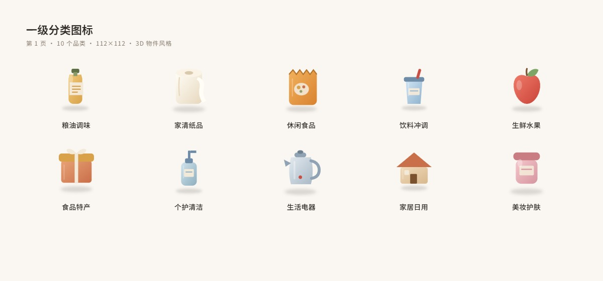
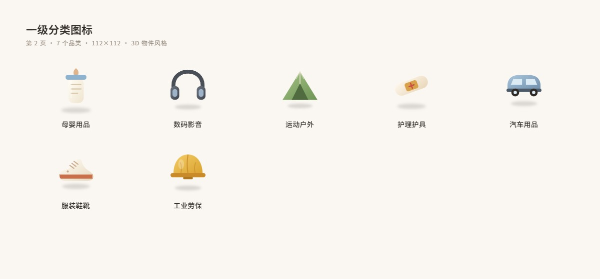

# 失败案例 v0：手绘 SVG 图标（误解风格）

- 日期：2026-11-26
- 状态：❌ failed（未交付，被 v1/v2 取代）
- 版本关系：v0（本案例）→ [v1 首次生成](2026-11-26-icons-v1-gen-failed.md) → [v2 通过](2026-11-26-icons-v2-passed.md)

## 期望

按用户给的商品图与参考图，设计 17 个一级分类图标，风格与参考一致。

## 实际做了什么

- 用 `lib/diff.js` 解码 15 张源图，统计尺寸/透明度/色数/亮度/饱和度；
- 手写 17 个内联 SVG：112×112 透明画布、单一渐变 + 白色高光 + 软椭圆投影，模拟「伪 3D」；
- 排进 Paper 两页画板，跑结构验收（渲染/居中/标签/审计）。

## 失败证据

问题肉眼可见：扁平小卡通、主体只占画布约 28%、没有参考图的浅色圆角卡和真实商品质感，与目标风格不是一类东西。

## 量化对比（每图标）

| 指标 | 源图（真实商品） | v0 SVG |
| --- | --- | --- |
| 唯一色数 | 156 | 75 |
| 边缘密度（细节） | 39.6% | 19.7% |
| 平均亮度 | 170 | 196（偏白） |
| 平均饱和度 | 0.30 | 0.20（偏淡） |
| 主体占画布 | 铺满 | 约 28% |

## 根因（四条，按重要性）

1. **没有图像输入**：当时模型配置丢了 `inputModalities`，`read_image` 不可用；我只能算像素统计，**没真正看过参考图**。
2. **风格理解错**：把「透明底商品抠图」当成了全部风格，忽略参考图的**圆角浅色底、真实商品照片、大号标签**——底卡才是风格主体。
3. **方法错配**：用矢量手绘去复刻照片级 3D 商品，路线本身不成立。
4. **验收错配**：只定义了结构指标（渲染/居中/无裁切/审计 0 high），**没有「像不像参考图」这一层**，所以丑图也能「验收通过」。

## 教训

- 需要看图的任务，先确认模型真的声明了图像输入；否则不要假装做了风格还原。
- 风格提取必须包含：底（色/形状/圆角）、商品呈现方式（照片/3D/插画）、占比、标签排版。
- 验收要分层：结构层 + 风格层（对照参考图逐项目检）。
- 照片级风格不要用 SVG 硬画；换图像生成或真实素材。

## 如何被修正

v1 改用 Paper 图像生成（能生成 3D 商品），但提示词不完整；v2 补上「整卡浅底、无底座、商品占满」后通过。
