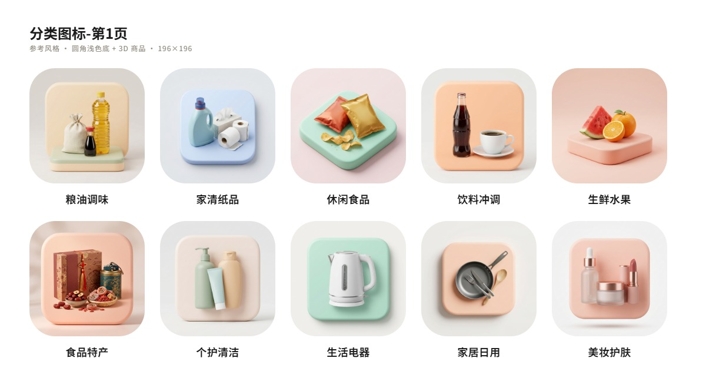
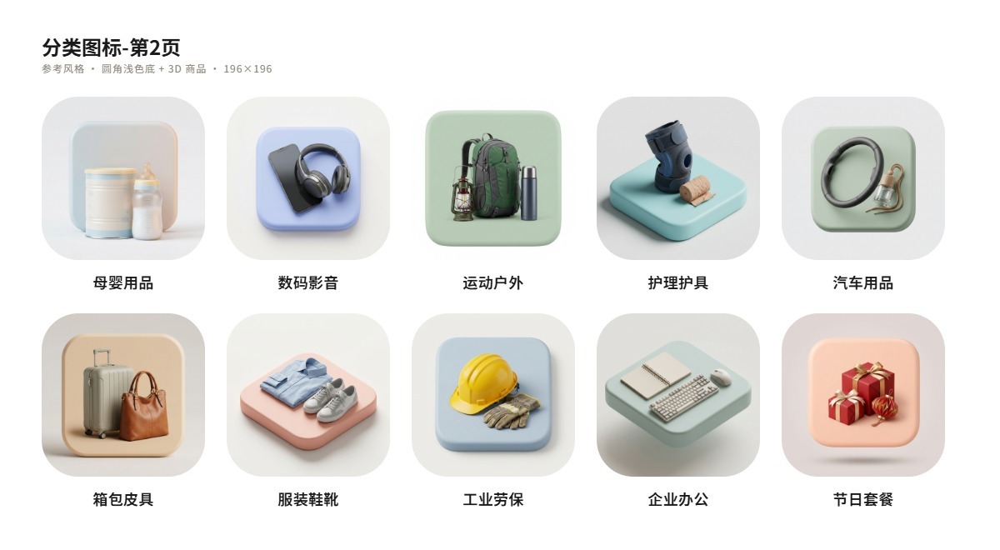

# 失败案例 v1：首次图像生成（有底座、灰棚底）

- 日期：2026-11-26
- 状态：❌ failed（被 v2 取代）
- 版本关系：[v0 手绘 SVG](2026-11-26-icons-v0-svg-failed.md) → v1（本案例）→ [v2 通过](2026-11-26-icons-v2-passed.md)

## 期望

改用 Paper `paper-gen://` 生成 20 个分类图标：圆角浅色卡 + 3D 商品 + 大标签。

## 实际做了什么

- 每个品类一条生成提示词，含 `pastel rounded square background`、`soft studio lighting`、`no text`；
- 5 列 × 2 行排两页，卡片 196、圆角 44、标签 18px/600；
- 20 张全部生成成功（20/20，0 error），随后截图交付。

## 失败证据

肉眼可见的问题：
- 商品站在**展示台/底座**上（护理护具、服装鞋靴、企业办公、节日套餐最明显）；
- 一半卡片变成**灰色摄影棚 + 内层色块**，不是整卡浅色；
- 商品只占卡约 **60%**，参考图约 80%；
- 标签 **18px** 偏小，与参考图比例不符；
- 节日套餐底色过饱和（正红），参考图是浅粉。

## 根因

1. **提示词缺负向约束**：只写了 `pastel rounded square background`，没说「不要底座、不要棚拍地板、不要背景板、要 edge-to-edge」。
2. **把「生成成功」当成「风格达标」**：20/20 成功只代表接口成功，不代表视觉合格。
3. **没有逐张目检**：交付前没有对着参考图检查每一张，结构验收替代了视觉验收。
4. **文字与版式没独立控制**：标签字号未按参考图比例设定。

## 教训

- 负向约束比正向描述更关键：`no pedestal / no platform / no studio floor / no backdrop / no table`。
- 底色要写「fills the entire square edge-to-edge」，否则模型会自由发挥成棚拍。
- 商品占比要显式写：`products fill most of the frame`。
- 生成后必须逐张目检；不合格的**单张重生成**，不要整页重来。
- 标签用 HTML 叠加并单独调字号，不依赖生成模型。
- 验收分两层：结构层 + 风格层。

## 如何被修正

v2 在同一生成模型上重写提示词（加负向约束、edge-to-edge、占满、无文字），标签放大到 22/700，重新生成 20 张后通过。
